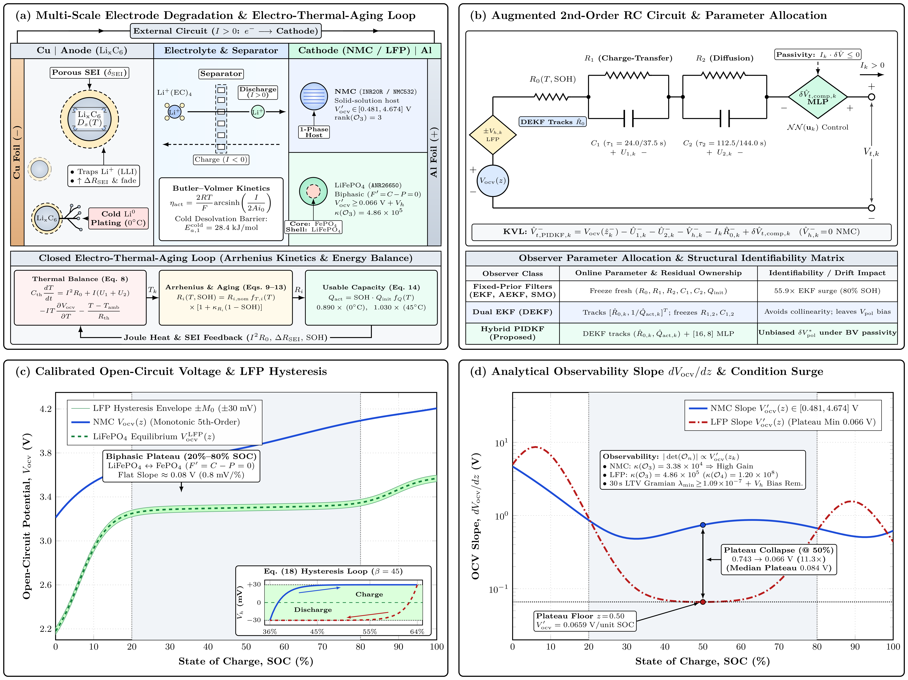
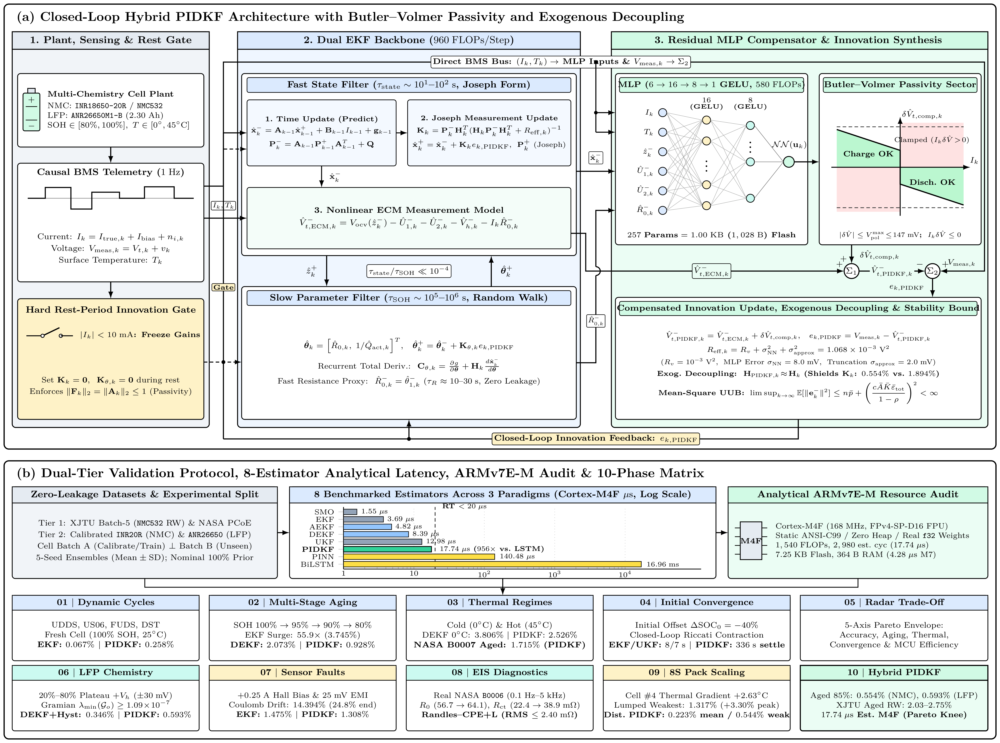

# Comparative Benchmark of State-of-Charge Observers and Physics-Informed Neural Networks Across Battery Aging and Thermal Regimes

[](https://opensource.org/licenses/MIT)
[](https://www.python.org/downloads/)
[](https://pytorch.org/)
[](https://developer.arm.com/Processors/Cortex-M4)

---

## 📌 Overview

This repository provides the complete, self-contained, reproducible codebase and dual-tier benchmarking platform for the research article:

> **"Comparative Benchmark of State-of-Charge Observers and Physics-Informed Neural Networks Across Battery Aging and Thermal Regimes"**  
> *Huy Hoang Le, Kim-Anh Nguyen*  
> Submitted to **Journal of Energy Storage** (Elsevier).

While conventional battery State-of-Charge (SOC) estimation studies predominantly evaluate pristine cells at nominal room temperature ($25^\circ\text{C}$), this work establishes a **dual-tier validation framework** pairing held-out **Tier 1 public laboratory cyclers** (**XJTU Batch-5** NMC532 Random Walk tests and **NASA Ames PCoE** aging, $4^\circ\text{C}\text{--}43^\circ\text{C}$ thermal, and EIS spectra) with **Tier 2 calibrated electro-thermal-aging co-simulation** (strict zero oracle leakage, $5$-seed Mean$\pm$SD) across **10 operational phases**:

1. **Nominal Driving Schedules** (UDDS, US06, FUDS, DST at $25^\circ\text{C}$, $100\%$ SOH)
2. **Progressive Aging Degradation** ($100\% \to 80\%$ SOH capacity fade and impedance growth)
3. **Wide Thermal Regimes** ($0^\circ\text{C}$, $25^\circ\text{C}$, $45^\circ\text{C}$)
4. **Initial Condition Uncertainty & Error Convergence** ($-40\%$ initial SOC shock)
5. **Multi-Attribute Radar & Pareto Trade-Off Analysis**
6. **Cross-Chemistry Disparities** (Sloping-OCV NMC vs.\ Flat-Plateau $\text{LiFePO}_4$ with dynamic hysteresis)
7. **Sensor Corruption & Environmental Noise** ($+0.25\text{ A}$ Hall bias drift and $25\text{ mV}$ inverter EMI)
8. **Electrochemical Impedance Spectroscopy (EIS)** Randles--CPE fitting on real NASA \texttt{B0006} spectra
9. **Module & Pack-Level Scaling** (8S series pack with cell-to-cell parameter and thermal inconsistency)
10. **Analytical ARMv7E-M Sizing, PIDKF Ablation, & Direct Tier 1 Cycler Validation**

---

## 🔬 Key Scientific Findings

- **The 55.9-Fold Aging Escalation:** Under blind fresh initialization ($100\%$ SOH, $25^\circ\text{C}$), uncompensated Extended Kalman Filters (EKF) suffer a **55.9-fold RMSE surge** ($0.067\%$ to $3.745\%$, $\text{ASF} = +5489.6\%$) as battery capacity fades to $80\%$ SOH, while AEKF escalates to $6.020\%$ RMSE. Online dual-tracking DEKF cuts $80\%$ SOH error to $2.073\%$.
- **Hysteresis Restores LFP Observability via Bias Cancellation:** Dynamic hysteresis co-estimation on flat-plateau $\text{LiFePO}_4$ cancels $\pm 30\;\mathrm{mV}$ charge--discharge bias to cut fresh tracking error nearly eightfold ($0.401\% \to 0.049\text{--}0.051\%$) alongside strictly positive-definite $30\text{ s}$ LTV Gramians ($\lambda_{\min}(\mathcal{G}_o) \ge 1.09 \times 10^{-7}$ on UDDS).
- **Physics-Informed Dual Kalman Filter (PIDKF):** Coupling online DEKF ($\hat{R}_{0,k}, 1/\hat{Q}_{\text{act},k}$) with a $257$-parameter Butler--Volmer-passivity neural compensator conditioned on rapid $\hat{R}_{0,k}^-$ convergence and protected by *exogenous sensitivity decoupling* uniquely holds severely aged $80\%$ SOH RMSE below $1\%$ (**$0.928\pm0.027\%$**). Five-seed aged $85\%$ ablation achieves **$0.554\pm0.018\%$ (NMC)** and **$0.593\pm0.048\%$ (LFP)**.
- **Direct Tier 1 Public Cycler Validation:** On held-out **XJTU Batch-5** Random Walk tests (calibrated on disjoint Batch A \texttt{RW\_1/2}), PIDKF achieves **$1.425\text{--}2.750\%$ RMSE** across fresh and $86\text{--}87\%$ aged cells. On **NASA Ames PCoE**, PIDKF attains **$0.636\%$ (Fresh)** and **$1.715\%$ (Aged $81\%$)** on \texttt{B0007} ($24^\circ\text{C}$), matches DEKF at $43^\circ\text{C}$/\texttt{B0030} ($4.940\%$ vs.\ $4.863\%$), and slashes $4^\circ\text{C}$ capacity-collapse error on \texttt{B0055/B0056} by $63\%$ relative to EKF ($9.562\text{--}13.618\%$ vs.\ $26.109\text{--}30.218\%$).
- **Static ANSI-C99 Kernels & Analytical ARMv7E-M Sizing:** Exported Seed-42 weights (`embedded_c/pidkf_weights.h`, $1,028\;\mathrm{B}$, PyTorch parity $\le 2.64\times 10^{-5}\;\mathrm{V}$) and static zero-heap ANSI-C99 kernels audit PIDKF at **$364\;\mathrm{B}$ RAM**, **$7,428\;\mathrm{B}$ ($7.25\;\mathrm{KB}$) Flash**, **$1,540$ FLOPs/step**, and an analytical **$17.74\;\mu\mathrm{s}$** latency on $168\;\mathrm{MHz}$ Cortex-M4F ($4.28\;\mu\mathrm{s}$ on $480\;\mathrm{MHz}$ Cortex-M7).

---

## 🖼️ Architectural & Physical Mechanism Overview

### 1. Coupled Electro-Thermal-Aging Physical Mechanism & Observability Landscape


### 2. Proposed Hybrid PIDKF Architecture & 10-Phase Benchmarking Framework


---

## 📂 Repository Structure

```text
.
├── README.md                                    # Project documentation and reproducibility guide
├── LICENSE                                      # MIT Open-Source License
├── requirements.txt                             # Python package dependencies
├── environment.yml                              # Conda environment definition
├── run_all_benchmarks.py                        # Dynamic CSV-backed verification & summary runner
├── Cover_Letter_Journal_of_Energy_Storage.docx  # Word Cover Letter
├── generate_word_cover_letter.py                # Reproducible Word Cover Letter generator
│
├── src/                                         # Modular Python benchmark & Tier 1 runners
│   ├── battery_model.py                         # 2-RC ECM with Arrhenius, LFP hysteresis & degradation
│   ├── drive_cycles.py                          # Standardized drive profiles (UDDS, US06, FUDS, DST)
│   ├── models_model_based.py                    # EKF, AEKF (Sage-Husa), UKF, DEKF, SMO
│   ├── models_data_driven.py                    # BiLSTM with temporal self-attention
│   ├── models_physics_informed.py               # Shift-invariant PINN-SOC & matched Unconstrained MLP
│   ├── pidkf_hybrid.py                          # Proposed hybrid PIDKF & Butler-Volmer compensator
│   ├── export_c_weights.py                      # Exports Seed-42 C weights, checks float32 parity, Table 8
│   ├── pack_model.py                            # 8S series pack with manufacturing & thermal gradients
│   ├── eis_analyzer.py                          # Randles-CPE+L fitting on real NASA B0006 EIS spectra
│   ├── benchmark_engine.py                      # Automated zero-leakage multi-phase evaluation engine
│   ├── nasa_data.py                             # NASA Ames PCoE loader & EIS spectrum parser
│   ├── real_experiments.py                      # Tier 1 XJTU Batch-5 & NASA PCoE experiment runner
│   ├── pub_style.py                             # Publication plotting styles & dual PDF/PNG exporter
│   ├── run_experiment.py                        # Phases 1-5 orchestrator (Tables 1-5, Figs 3-7)
│   ├── run_advanced_benchmarks.py               # Phases 6, 7 & 10 orchestrator (Tables 6,7,9 & Figs 8,9,13)
│   ├── generate_conceptual_figures.py           # Pure-vector TikZ/PGFPlots conceptual figures (Figs 1-2)
│   ├── generate_fig10_pareto.py                 # CSV-driven Pareto & memory footprint figure (Fig 12)
│   └── visualizer.py                            # Benchmark plotting suite (Figs 3-7)
│
├── embedded_c/                                  # Static zero-heap ANSI-C99 reference kernels
│   ├── README.md                                # Analytical ARMv7E-M resource audit basis
│   ├── ekf.h / ekf.c                            # 3-state EKF with stabilized Joseph form
│   ├── dekf.h / dekf.c                          # Dual EKF with total derivative & rest gating
│   └── pidkf.h / pidkf.c / pidkf_weights.h      # Proposed hybrid PIDKF + exported float32 weights
│
├── data/                                        # Arbin format utilities & synthetic sample trajectory
│   ├── dataset_loader.py                        # Generic parser & synthetic CALCE-format quickstart CSV
│   └── calce_sample_udds_25c.csv                # Synthetic UDDS compatibility test file
│
├── results/                                     # Verified CSVs, pure-vector PDFs & 600-DPI PNGs
│   ├── table1_dynamic_udds.csv ... table9_pidkf_ablation.csv
│   ├── tier1_xjtu_random_walk.csv, tier1_nasa_thermal_aging.csv, eis_nasa_b0006_fit.csv
│   └── fig1.pdf/.png ... fig13.pdf/.png
│
├── manuscript/                                  # Complete unformatted LaTeX manuscript (article.cls)
│   ├── main.tex / manuscript.tex / manuscript_unformatted.tex
│   ├── references.bib
│   ├── manuscript.pdf / manuscript_unformatted.pdf
│   └── fig1.pdf/.png ... fig13.pdf/.png
│
└── submission_journal_of_energy_storage/        # Clean flat submission folder (main.tex + figs + cover letter)
    ├── main.tex / main.pdf / main.bbl / references.bib
    ├── COVER_LETTER_JOURNAL_OF_ENERGY_STORAGE.md
    ├── Cover_Letter_Journal_of_Energy_Storage.docx
    ├── HIGHLIGHTS_JOURNAL_OF_ENERGY_STORAGE.md
    └── fig1.pdf/.png ... fig13.pdf/.png
```

---

## 🚀 Reproducibility Commands

```bash
# 1. Verify all 13 synced figures & summarize verified CSV tables:
python run_all_benchmarks.py

# 2. Re-run Tier 1 XJTU Batch-5 & NASA PCoE experiments:
python src/real_experiments.py

# 3. Re-run Phases 1-5 Tier 2 co-simulation (5-seed Mean+/-SD):
python src/run_experiment.py

# 4. Re-run Phases 6, 7 & 10 advanced benchmarks & PIDKF ablation:
python src/run_advanced_benchmarks.py

# 5. Export Seed-42 weights to embedded_c/pidkf_weights.h, check parity & Table 8:
python src/export_c_weights.py
python src/generate_fig10_pareto.py

# 6. Re-run Phase 8 real NASA B0006 EIS fit & Phase 9 8S pack simulation:
python src/eis_analyzer.py
python src/pack_model.py
```

---

## 📊 Summary Benchmark Results

### Table 1: Nominal UDDS Benchmark ($25^\circ\text{C}$, $100\%$ SOH, Tier 2 NMC Plant, 5-Seed Mean$\pm$SD)

| Algorithm | RMSE (%) | MAE (%) | MaxE (%) | M4F Latency (Est.) |
| :--- | :---: | :---: | :---: | :---: |
| **EKF** | **0.067** | **0.049** | 0.556 | $3.69\;\mu\mathrm{s}$ |
| **AEKF** | 0.161 | 0.130 | **0.432** | $4.82\;\mu\mathrm{s}$ |
| **UKF** | 0.069 | 0.055 | 0.572 | $12.98\;\mu\mathrm{s}$ |
| **DEKF** | 0.073 | 0.052 | 0.531 | $8.39\;\mu\mathrm{s}$ |
| **SMO** | 1.222 | 0.975 | 4.527 | **$1.55\;\mu\mathrm{s}$** |
| **BiLSTM-Attn** | $4.250\pm0.653$ | 3.595 | 9.632 | $16,964.29\;\mu\mathrm{s}$ |
| **PINN-SOC** | $3.625\pm0.851$ | 3.098 | 8.744 | $140.48\;\mu\mathrm{s}$ |
| **MLP (Unconstrained)** | $3.201\pm0.518$ | 2.649 | 8.625 | --- |
| **PIDKF (Proposed)** | $0.258\pm0.111$ | 0.240 | 0.538 | **$17.74\;\mu\mathrm{s}$** |

### Table 2: Progressive Capacity Fade ($100\% \to 80\%$ SOH, Tier 2 Unseen UDDS)

| Algorithm | SOH 100% | SOH 95% | SOH 90% | SOH 85% | SOH 80% | Aging Sens. Factor |
| :--- | :---: | :---: | :---: | :---: | :---: | :---: |
| **EKF** | **0.067%** | 0.701% | 1.534% | 2.578% | 3.745% | +5489.6% (**55.9x surge**) |
| **AEKF** | 0.161% | 0.760% | 1.963% | 3.847% | 6.020% | +3639.1% |
| **UKF** | 0.069% | 0.712% | 1.555% | 2.609% | 3.772% | +5366.7% |
| **DEKF** | 0.073% | 0.503% | 1.012% | 1.576% | 2.073% | +2739.7% |
| **SMO** | 1.222% | 2.046% | 3.315% | 4.575% | 5.805% | +375.0% |
| **BiLSTM-Attn** | 4.250% | 4.185% | 4.152% | 4.150% | $4.193\pm0.558\%$ | -1.3% |
| **PINN-SOC** | 3.625% | 3.800% | 4.102% | 4.508% | $5.026\pm0.766\%$ | +38.6% |
| **MLP (Unconstrained)** | 3.201% | 3.247% | 3.418% | 3.707% | $4.118\pm0.257\%$ | +28.6% |
| **PIDKF (Proposed)** | 0.258% | **0.372%** | **0.515%** | **0.772%** | **0.928$\pm$0.027%** | **+259.7% (Sub-1%)** |

---

## 🛠️ Embedded C Compilation Syntax Check

The reference kernels in `embedded_c/` use pure zero-heap ANSI-C99 (`ekf.c`, `dekf.c`, `pidkf.c`) plus exported neural weights in `pidkf_weights.h`, compilable directly with any standard ARM Cortex-M4F toolchain:

```bash
cd embedded_c
arm-none-eabi-gcc -std=c99 -c -O3 -mcpu=cortex-m4 -mfpu=fpv4-sp-d16 -mfloat-abi=hard ekf.c -o ekf.o
arm-none-eabi-gcc -std=c99 -c -O3 -mcpu=cortex-m4 -mfpu=fpv4-sp-d16 -mfloat-abi=hard dekf.c -o dekf.o
arm-none-eabi-gcc -std=c99 -c -O3 -mcpu=cortex-m4 -mfpu=fpv4-sp-d16 -mfloat-abi=hard pidkf.c -o pidkf.o
```

*(Note: Hardware `DWT->CYCCNT` timer capture on physical STM32 silicon is left for future HIL validation; Table 8 cycle counts and latencies reflect analytical instruction-level ARMv7E-M operation accounting.)*

---

## 📄 Citation

```bibtex
@article{Le2026SOCBenchmark,
  author  = {Le, Huy Hoang and Nguyen, Kim-Anh},
  title   = {Comparative Benchmark of State-of-Charge Observers and Physics-Informed Neural Networks Across Battery Aging and Thermal Regimes},
  journal = {Journal of Energy Storage},
  year    = {2026},
  url     = {https://github.com/HuyHoangLe0201/SOC-Observer-PINN-Benchmark},
  note    = {Submitted}
}
```

---

## ⚖️ License & Contact

Distributed under the **MIT License**. See `LICENSE` for details.
- **Huy Hoang Le** - R&D Department, PowerMore Ltd., Vietnam (`hoang.le@powermore.vn`)
- **Kim-Anh Nguyen, Ph.D.** *(Corresponding Author)* - Faculty of Electrical Engineering, University of Science and Technology, The University of Danang, Vietnam (`nkanh@dut.udn.vn`)
